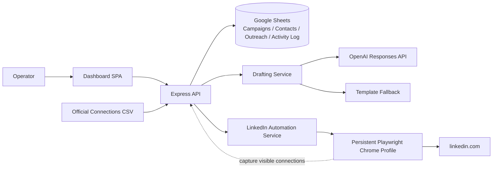
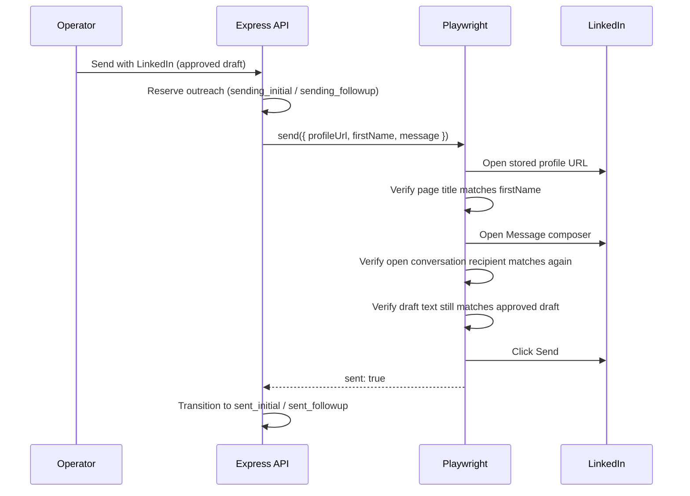
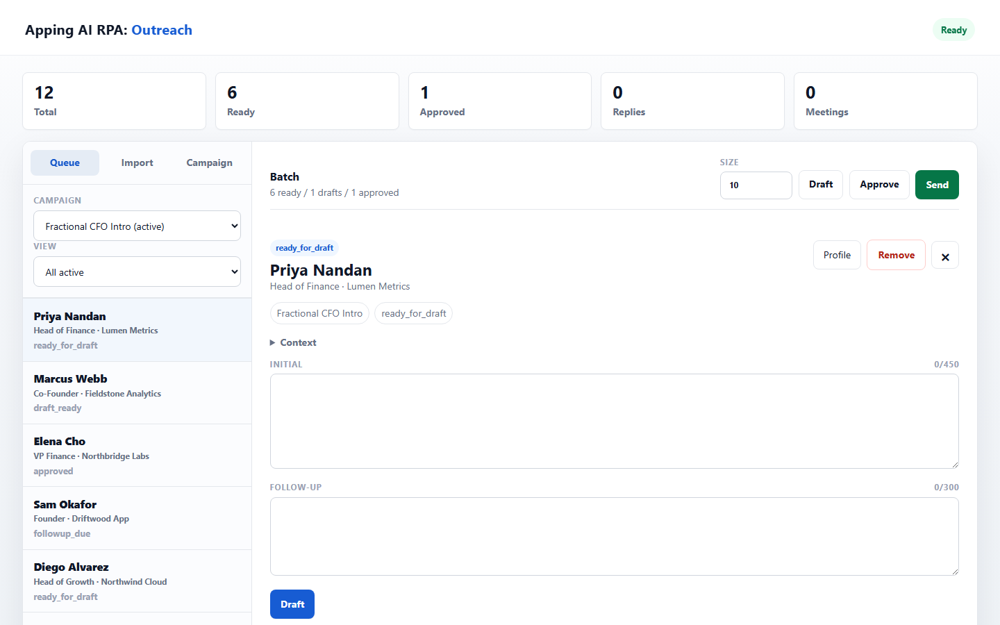
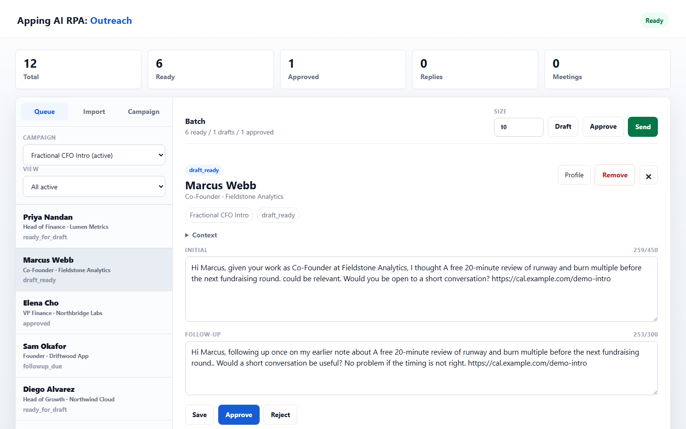
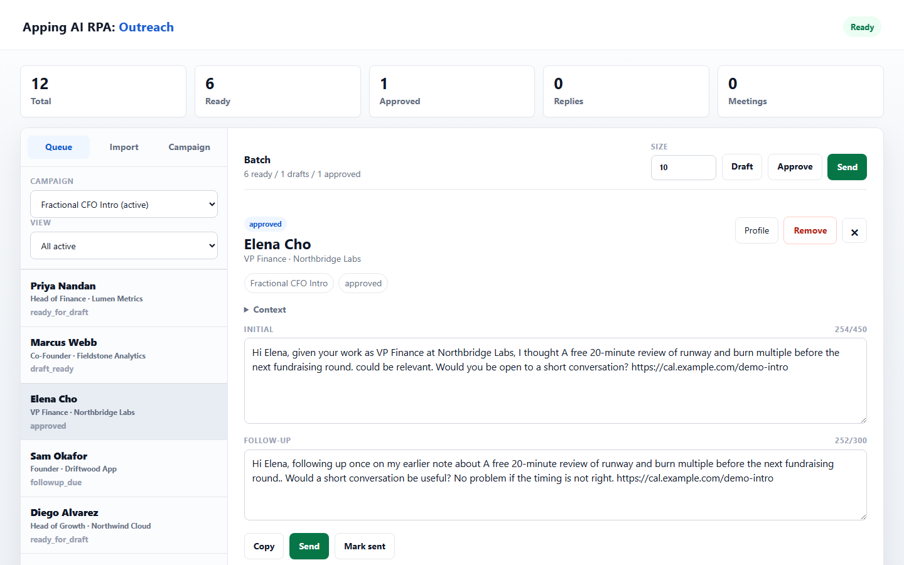
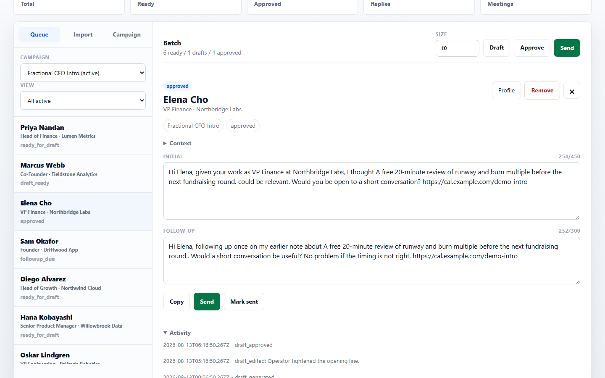
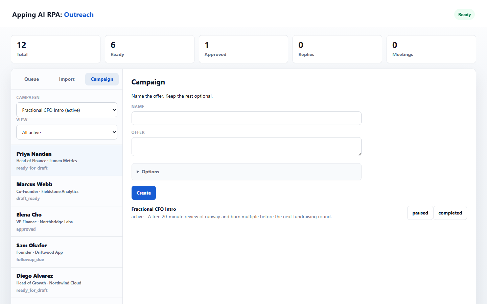
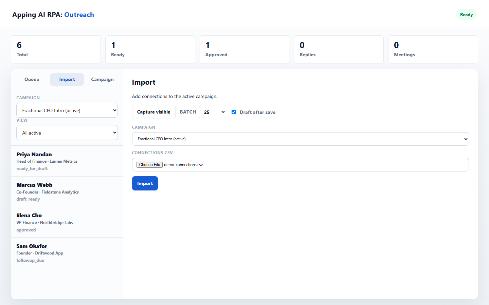

# Outreach Sentinel

> [!NOTE]
> This repository is a sanitized engineering case study. It explains the architecture, workflows, safety boundaries, and engineering decisions behind an attended LinkedIn outreach system without exposing secrets, service-account credentials, browser session data, or real connection records.

| Context | Team | Status | My part |
| --- | --- | --- | --- |
| AI Engineering Internship, Apping Technology Sdn. Bhd. (2026) | Engineering team | Used by real users | [My contributions →](docs/12-my-contributions.md) |

## Overview

**Outreach Sentinel** (internally named "Apping AI RPA: Outreach") is an attended outreach system for existing LinkedIn connections. It imports LinkedIn's official connections export, drafts professional, fact-only messages with an AI-assisted fallback-safe writer, and lets an operator send the approved draft through a real, visible LinkedIn session using Playwright. Every record, transition, and send is tracked in Google Sheets with a full audit trail.

The project solves a narrow but easy-to-get-wrong problem: reaching out to real connections at scale without ever risking a fabricated claim, a message sent to the wrong person, a duplicate send, or a stealth automation pattern that could put the operator's account at risk.

<strong>Portfolio Snapshot</strong>

| Dimension | Summary |
| --- | --- |
| Product | Attended, human-approved LinkedIn outreach workspace |
| Backend | Node.js, Express 5, Zod-validated config |
| System of record | Google Sheets (Campaigns, Contacts, Outreach, Activity Log) |
| Drafting | OpenAI Responses API with a deterministic template fallback |
| Browser automation | Playwright, persistent operator-owned Chrome profile |
| Frontend | Single-page vanilla JS dashboard served statically |
| Safety model | Double identity verification, idempotency, optimistic concurrency |
| Test coverage | 23 automated tests across domain, drafting, importer, RPA, and API layers |

## Project Summary

The system turns "message my LinkedIn connections about an offer" into a controlled, auditable pipeline: import or capture connections, qualify them against campaign rules, generate a draft that only uses approved facts, let a human review and approve it, and only then open a real browser session to verify the recipient and click Send. Nothing is sent automatically, and nothing is sent to a profile the system has not independently verified twice.

## Feature Highlights

| Area | Capability | Why It Matters |
| --- | --- | --- |
| Connection import | Parses LinkedIn's official `Connections.csv` export, deduplicates by a stable content-derived ID | Uses the platform's own data export instead of scraping |
| Live capture | Scrolls and reads the visible connections page in an attended browser as an alternative to CSV | Lets an operator pull a fresh batch without leaving LinkedIn |
| Cross-campaign suppression | Blocks re-importing anyone already messaged, mid-flow, or opted out, in *any* campaign | Prevents duplicate or unwanted outreach across overlapping campaigns |
| AI drafting with fallback | OpenAI Responses API drafts within character limits; a deterministic template always exists if the API is unavailable or the draft fails validation | The workspace never blocks on the AI provider |
| Fact-only validation | Regex- and rule-based checks block sensitive-attribute references, fabricated familiarity, mismatched greetings, and unapproved URLs | Keeps every message honest and compliant before a human ever sees it |
| Attended send | Playwright opens the *stored* profile URL, verifies the page title matches the intended recipient, verifies the open conversation matches again, types the exact approved draft, and clicks Send | Two independent identity checks before a message ever reaches someone |
| State machine | An explicit `OUTREACH_STATUSES` graph with an allow-list of legal transitions | Impossible states (e.g. sending a draft that was never approved) are rejected at the data layer |
| Optimistic concurrency + idempotency | Every write carries a `version` check and an idempotency key logged to the Activity Log | Safe to retry after a crash or a double click without double-sending |
| Follow-up scheduling | One automatic follow-up, due five business days later in the campaign's configured timezone | Matches a realistic, non-spammy outreach cadence |
| Batch operations | Draft, approve, or send up to a configurable batch size in one pass, each item independently reserved and rolled back on failure | Lets an operator process a queue without babysitting every contact |

## Technology Stack

| Layer | Technologies |
| --- | --- |
| Runtime | Node.js (ES modules), Express 5 |
| Configuration | dotenv, Zod schema validation |
| System of record | Google Sheets API v4 (`googleapis`), append-only Activity Log |
| AI drafting | OpenAI Responses API, configurable model and reasoning effort |
| Browser RPA | Playwright, persistent Chrome profile, attended (non-headless by default) |
| CSV parsing | `csv-parse` against LinkedIn's official connections export |
| Time handling | Luxon, business-day math in a configurable IANA timezone |
| Validation | Zod (config), hand-written domain validators (drafts, transitions) |
| Frontend | Static HTML/CSS and vanilla JS single-page dashboard |
| Testing | Node's built-in test runner (`node --test`), 23 tests across 7 suites |
| Logging | Pino, `pino-http` request logging |

## Architecture Preview

[Read the full architecture](docs/03-system-architecture.md)

## Send-Safety Preview

[Read the automation safety model](docs/05-linkedin-automation-safety.md)

## Screenshot Gallery

Captured from a sanitized, throwaway demo workspace — an in-memory backend seeded with fabricated names and companies, running the real application code, never the production Google Sheet or a real LinkedIn session.

| Operator Queue | Draft Review |
| --- | --- |
|  |  |
| The queue after a demo CSV import, sorted across ready, drafted, approved, and follow-up-due contacts. | An editable draft with live character counters, generated by the template fallback writer. |

| Attended Send Surface | Audit Trail |
| --- | --- |
|  |  |
| The state immediately before an attended Playwright send — nothing fires without this explicit click. | Every transition for one outreach record, in order, with operator notes. |

| Campaign Setup | Import |
| --- | --- |
|  |  |
| Campaign rules — offer, tone, exclusions, booking URL — authored once per audience. | The CSV import entry point, ready to qualify and suppress a fabricated connections export. |

The live-browser "capture visible connections" and "send with LinkedIn" states are intentionally not shown — both require a real, logged-in LinkedIn session, which is out of scope for a sanitized portfolio asset. See the [screenshot plan](screenshots/README.md) for the full capture list and the reasoning behind that boundary.

## Documentation Navigation

| Document | What It Explains |
| --- | --- |
| [01 Executive Summary](docs/01-executive-summary.md) | Portfolio-level summary and technical value |
| [02 Business Problem](docs/02-business-problem.md) | Why attended, fact-only outreach automation matters |
| [03 System Architecture](docs/03-system-architecture.md) | Components, boundaries, and data flow |
| [04 AI Drafting Workflow](docs/04-ai-drafting-workflow.md) | Responses API drafting, validation, and the template fallback |
| [05 LinkedIn Automation & Safety](docs/05-linkedin-automation-safety.md) | Playwright send flow and the double identity-verification model |
| [06 Import & Capture](docs/06-import-and-capture.md) | CSV import, live capture, deduplication, and suppression |
| [07 Outreach State Machine](docs/07-outreach-state-machine.md) | The status graph, legal transitions, and terminal states |
| [08 Data Model](docs/08-data-model.md) | The four Google Sheets tabs and their fields |
| [09 API Overview](docs/09-api-overview.md) | Endpoint-by-endpoint behavior |
| [10 Engineering Decisions](docs/10-engineering-decisions.md) | Trade-offs and architectural reasoning |
| [11 Challenges](docs/11-challenges.md) | Platform fragility, rate limits, and identity risk |
| [12 My Contributions](docs/12-my-contributions.md) | Contribution narrative for portfolio reviewers |
| [13 Future Improvements](docs/13-future-improvements.md) | Roadmap for production hardening |
| [Appendix](docs/appendix.md) | Glossary, safety checklist, and reviewer notes |
| [Diagram Plan](diagrams/README.md) | Editable Mermaid diagram inventory |
| [Screenshot Plan](screenshots/README.md) | Capture list and privacy guidance |

## Key Achievements

- Designed an outreach state machine with an explicit allow-list of legal transitions, enforced at the repository layer, not just the UI.
- Built a drafting service that never blocks on an external AI provider: every draft, AI-generated or not, passes the same fact-only validator before it can be approved.
- Implemented a two-layer identity verification model in the Playwright send flow — profile page title, then open-conversation recipient — so a message can never reach the wrong person.
- Added optimistic concurrency (`version` + `expectedVersion`) and idempotency keys on every write, with a full Activity Log audit trail, so retries after a crash or double click are always safe.
- Built cross-campaign suppression so a connection already in progress, already messaged, or opted out in one campaign is automatically excluded from every other campaign.
- Added a live "capture visible connections" RPA path as an alternative to CSV import, with the same suppression and qualification rules applied in-browser.
- Reached 23 passing automated tests covering the domain state machine, drafting validation, CSV import, LinkedIn automation guards, config parsing, sheet setup, and end-to-end API behaviors.

## Limitations

What this case study does not show, and what the system does not yet do:

- Source code, contact data and credentials are private; the test output and log excerpts in the docs are the public evidence.
- Google Sheets is the system of record, and its per-minute read quota is reached under batch load (documented in [Challenges](docs/11-challenges.md)).
- It is a single-operator tool: there is no authentication, and actions are attributed through one configured operator name.
- LinkedIn selectors can change, and there is no periodic selector self-check yet.
- The 23 automated tests cover domain rules, drafting, import, send guards and the API; the DOM-dependent send branches have no mocked Playwright fixtures yet.
- Transient Google API errors are not retried automatically.

## Lessons Learned

> [!IMPORTANT]
> The hardest part of outreach automation is not sending a message — it is proving, twice, that the message is going to the right person, and proving that every claim in it is true.

- A deterministic template fallback is what makes an "AI-powered" feature trustworthy: the workspace keeps working, identically validated, even when the model is unavailable.
- Optimistic concurrency and idempotency keys matter more in a Sheets-backed system than in a traditional database, because there is no transaction boundary to fall back on.
- Google Sheets is a fine system of record for pilot-scale outreach, but its per-minute read quota is a real operational constraint once activity volume grows — visible directly in this project's own request logs.
- Treating "attended" as a first-class design constraint (not a temporary limitation) produces a safer, more auditable system than trying to make automation invisible.
- Validating a draft in the same way at generation time, at approval time, and again immediately before the Send click closes the gap between "looked fine when written" and "still true when sent."

---

**Part of [Bakary Gibba's AI engineering portfolio](https://github.com/BakaryGibba/bakary-gibba-ai-engineering-portfolio)**

[Portfolio website](https://bakary-gibba.vercel.app/) · [LinkedIn](https://www.linkedin.com/in/bakary-gibba-6409bb248/) · [Google Scholar](https://scholar.google.com/citations?user=bp0G4sgAAAAJ&hl=en)

