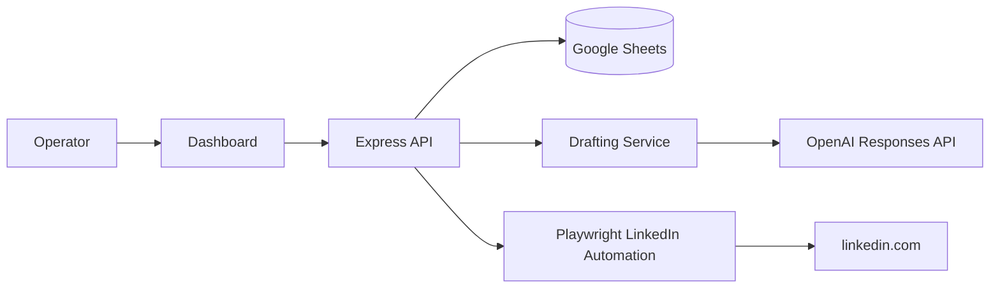

[Back to README](../README.md)

# 01 Executive Summary

## Overview

Outreach Sentinel is an attended automation system for reaching out to existing LinkedIn connections. It coordinates Google Sheets as the system of record, an OpenAI-backed drafting service with a deterministic fallback, and a Playwright-driven browser automation service that operates a real, visible LinkedIn session on the operator's behalf.

The project demonstrates practical automation engineering under a hard constraint: the system must never send a fabricated claim, never send to the wrong person, and never send twice. Every design decision — the state machine, the idempotency keys, the double identity verification — traces back to that constraint.

## Product Narrative

Reaching out to a large connections list by hand is slow and error-prone: operators lose track of who has been contacted, copy-paste the wrong draft into the wrong conversation, or send a follow-up to someone who already replied. Full automation removes the toil but introduces a worse risk — a bot that sends confident, professional-sounding messages containing claims nobody can stand behind, to people it has not actually verified.

This project resolves that tension with a queue-first, human-approved workflow:

| Step | System Responsibility |
| --- | --- |
| Import | Parse the official LinkedIn connections export or capture the visible connections page live |
| Qualify | Apply campaign exclusion rules and flag incomplete contacts for manual context |
| Draft | Generate an initial and follow-up message using only approved facts, AI-assisted or template-based |
| Approve | Require a human to review, edit, and approve every draft before it can be sent |
| Send | Open a real browser session, verify the recipient twice, type the exact approved text, click Send |
| Track | Record every transition to an append-only Activity Log with an idempotency key |

## Engineering Value

The case study is valuable because it shows how to build automation around a platform where trust and account safety matter more than throughput. The design treats "attended" as a permanent feature, not a stepping stone toward a fully autonomous bot, and it shows how far that constraint can be pushed while still being genuinely useful: batch drafting, batch approval, batch sending, and a live capture path that avoids the CSV round-trip entirely.

## System at a Glance

## Screenshot

The operator queue after a demo CSV import, showing fabricated contacts across `ready_for_draft`, `draft_ready`, `approved`, and `followup_due`. Captured from a sanitized, in-memory demo workspace — never the production Google Sheet. See the [screenshot plan](../screenshots/README.md) for how it was captured.
