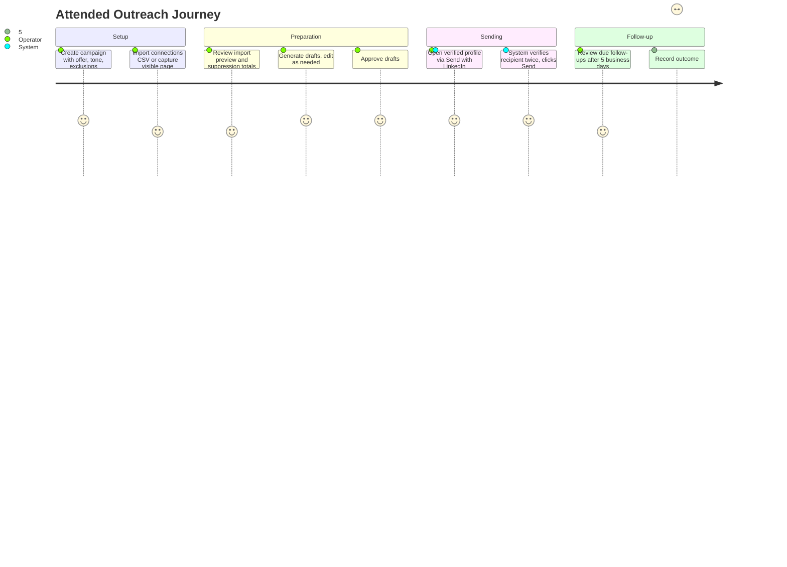

[Back to README](../README.md)

# 02 Business Problem

## Problem

An operator with a genuine offer — a service, a partnership, a role — wants to reach out to relevant people already in their LinkedIn network. Doing this by hand across dozens or hundreds of connections is slow, hard to track, and easy to get wrong: duplicate messages, stale follow-ups sent after someone already replied, or a message accidentally sent to the wrong profile.

Fully autonomous outreach bots solve the throughput problem but introduce two risks the operator cannot accept: messages that imply familiarity or facts nobody can verify, and LinkedIn account restrictions triggered by stealth, non-human automation patterns.

## Stakeholders

| Stakeholder | Need |
| --- | --- |
| Operator | Send honest, personalized outreach without manual copy/paste and status tracking |
| Message recipient | Receive a message that is accurate, relevant, and easy to decline |
| Account owner | Avoid LinkedIn restrictions from stealth or bulk-sending automation patterns |
| Campaign owner | Know exactly who has been contacted, who is due for follow-up, and who has opted out |

## Success Criteria

- One official LinkedIn export (or a live capture) can seed a campaign queue in minutes.
- Every draft uses only facts recorded on the contact or campaign — no invented familiarity.
- A human reviews and approves every message before it can be sent.
- The system independently verifies the recipient twice before a send is allowed to happen.
- No connection is ever messaged twice for the same offer, or messaged again after opting out, even across different campaigns.
- Every status change is recorded with who/what/when for later audit.

## User Journey

## Screenshot

The import entry point: a demo campaign selected and a fabricated `demo-connections.csv` attached, ready to be qualified and suppressed before anything is written to the queue. See the [screenshot plan](../screenshots/README.md) for how it was captured.
