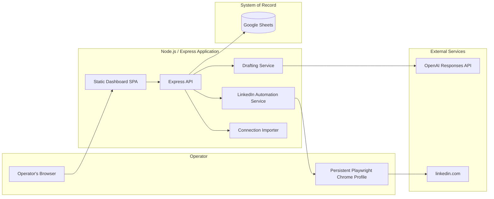

[Back to README](../README.md)

# 03 System Architecture

## Architecture Summary

The application is a single Node.js/Express service (`src/app.js`) composed from four collaborators that are wired together at startup: a `GoogleSheetsRepository` acting as the system of record, a `DraftingService` for AI-assisted message writing, a `LinkedInAutomationService` wrapping a persistent Playwright browser context, and an in-memory `ImportPreviewStore` for short-lived import/capture previews. A static single-page dashboard is served directly by Express from `src/public/`.

## Component Responsibilities

| Component | File | Responsibility |
| --- | --- | --- |
| Express app | `src/app.js` | Routes, request validation, cross-cutting suppression logic, batch orchestration |
| Config loader | `src/config.js` | Zod-validated environment configuration, service-account credential resolution |
| Domain model | `src/domain/model.js` | Sheet schemas, the outreach state machine, row/object mapping |
| Google Sheets repository | `src/repositories/googleSheetsRepository.js` | All reads/writes to Sheets, optimistic concurrency, activity logging |
| Drafting service | `src/services/drafting.js` | AI drafting, template fallback, fact-only validation |
| LinkedIn automation | `src/services/linkedinAutomation.js` | Playwright send flow and live connection capture |
| Connection importer | `src/services/connectionImporter.js` | CSV parsing, identity fingerprinting, import preview construction |
| Sheet setup | `src/services/sheetSetup.js` | One-time/idempotent creation of tabs, headers, filters, and data validation |
| Dashboard | `src/public/` | Static HTML/CSS/JS operator workspace |

## Data Flow

1. The operator authors a campaign, imports or captures connections, and the importer builds an in-memory preview.
2. A cross-campaign suppression pass (`applyCrossCampaignSuppression` in `src/app.js`) filters the preview against everything already in Sheets before it can be committed.
3. Committed rows are written to the `Contacts` and `Outreach` tabs in a single batched Sheets write, alongside an `Activity Log` entry.
4. The drafting service reads only the approved `Contacts`/`Campaigns` fields, generates a draft, and the same validator that gates AI output also gates manual edits and the final pre-send check.
5. On send, the LinkedIn automation service opens the *stored* profile URL (never a URL typed at send time), and the Express layer wraps the call in a reservation + lock + idempotency key so a crash mid-send cannot double-send.

## No Database, By Design

There is no SQL or NoSQL database in this system. Google Sheets *is* the database: four tabs (`Campaigns`, `Contacts`, `Outreach`, `Activity Log`) with fixed header rows validated on every health check (`GET /api/health` calls `repository.validateSchema()`). This keeps the system inspectable and editable by a non-engineer operator, at the cost of the API's per-minute read/write quotas — a trade-off discussed further in [10 Engineering Decisions](10-engineering-decisions.md) and [11 Challenges](11-challenges.md).

## Screenshot

The health indicator turns "Ready" only once `GET /api/health` confirms the backing store is reachable and its schema matches. In this sanitized demo it reflects the in-memory workspace; in production it reflects the live Google Sheet.

See the [screenshot plan](../screenshots/README.md) for capture status.
