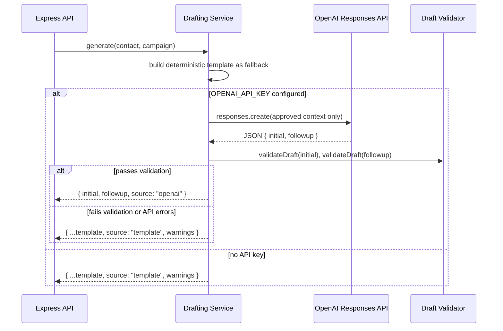

[Back to README](../README.md)

# 04 AI Drafting Workflow

## Summary

`DraftingService` (`src/services/drafting.js`) generates two messages per contact — an initial outreach (≤450 characters) and a single follow-up (≤300 characters) — using the OpenAI Responses API when a key is configured, and a fully deterministic template writer when it is not. Critically, **both paths run through the exact same fact-only validator**, so "AI-drafted" never means "less scrutinized."

## Generation Flow



## What the Model Is Allowed to See

The prompt sent to the Responses API is deliberately narrow — only fields the operator explicitly recorded:

```js
const approvedContext = {
  contact: { first_name, company, position, relationship_context },
  campaign: { offer, tone, proof_points, booking_url }
};
```

The developer instruction is explicit: *"Write professional LinkedIn outreach using only supplied facts. Never invent familiarity, achievements, interests, or profile activity."* The model is configured via `OPENAI_MODEL` and `OPENAI_REASONING_EFFORT`, and asked to return JSON only, which the service extracts with a permissive brace-matching parser (`extractJson`).

## The Deterministic Fallback

`templateDrafts(contact, campaign)` builds a message from string concatenation, not a model call: a greeting, a relevance clause built from `relationship_context` or the contact's role/company, an offer statement stripped of trailing questions, and a closing that asks for a short conversation and appends the campaign's booking URL if one is set. `fitWithClosing` trims the message word-by-word from the end until it fits the character budget while still ending in a complete sentence plus the closing ask. This path requires no network call and cannot fail for reasons other than a bug — it is always available.

## The Fact-Only Validator

`validateDraft(text, { maxLength, contact, campaign, requireMeetingAsk })` is the single gate every draft passes through — at generation, at manual save, at approval, and again immediately before the Playwright send. It checks:

| Check | Rule |
| --- | --- |
| Not empty | Draft must contain text |
| Length | Must not exceed the caller's `maxLength` |
| Not cut off | Must end in `.`, `!`, `?`, or those followed by a URL |
| Greeting matches | `Hi {name},` must match `contact.first_name` (Unicode-aware, case/diacritic-insensitive) |
| No sensitive attributes | Blocks references to race, religion, disability, medical status, pregnancy, sexual orientation, or political affiliation |
| No fabricated familiarity | Blocks phrases like *"I saw your recent post"* or *"we met at"* unless `relationship_context` is actually set |
| Meeting ask present | Must contain a word like meet/meeting/call/conversation/chat/speak/talk |
| No unapproved links | If the draft contains a URL, it must be the campaign's approved `booking_url` |

If the AI draft fails any of these checks, the service silently substitutes the template draft and surfaces the validation errors as `warnings` in the API response rather than surfacing a broken message to the operator.

## Screenshot


A `draft_ready` contact with both messages generated by the template fallback (no `OPENAI_API_KEY` in this demo), showing the live 259/450 and 253/300 character counters the operator watches while editing.

See the [screenshot plan](../screenshots/README.md) for capture status.
