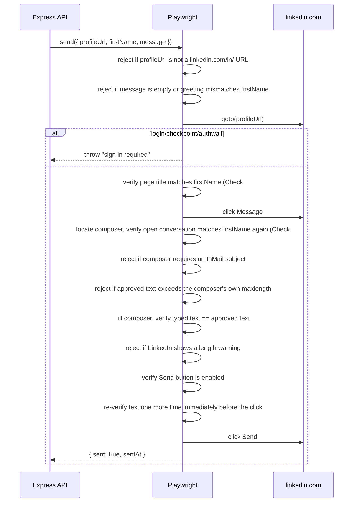

[Back to README](../README.md)

# 05 LinkedIn Automation & Safety

## Summary

`LinkedInAutomationService` (`src/services/linkedinAutomation.js`) drives a single persistent Playwright Chrome context (`chromium.launchPersistentContext`) bound to a dedicated user-data directory. It is attended by design: `LINKEDIN_HEADLESS=false` by default, so login prompts, checkpoints, and 2FA challenges are always visible and solvable by the operator, and the same visible window is reused across sends so LinkedIn sees one continuous human session rather than a wave of fresh, unauthenticated browser instances.

The service exposes two capabilities: `send()`, which delivers one approved message, and `captureVisibleConnectionsOnce()`, which scrolls and reads the operator's own visible connections page as a live alternative to the CSV import.

## Send Flow and the Double Identity Check

Two independent checks stand between "open a profile" and "click Send":

1. **Profile identity check** — after navigation, the page `<title>` (with the trailing `| LinkedIn` suffix stripped) must match `firstName`. A mismatch throws before any UI interaction happens.
2. **Open-conversation recipient check** — after the message composer opens, the service walks the DOM around the composer (headings, `[data-anonymize="person-name"]`, recipient pills, nearby inputs) looking for visible text that matches the *same* expected name a second time, independently of the first check. If nothing matches, the send is aborted with "Nothing was sent."

Before either check runs, `send()` already rejects if the draft's greeting name doesn't match the contact's first name and if the draft doesn't end in a complete sentence — the same rule the drafting validator enforces, checked again here as defense in depth.

## Composer-Level Guards

Beyond identity, the service checks the live composer state before clicking Send:

- **InMail subject required** → aborts; a standard connection message flow was expected.
- **Composer's own `maxlength` exceeded** → aborts with the exact character counts.
- **Typed text differs from the approved draft** (LinkedIn's editor reformatted or truncated it) → aborts.
- **LinkedIn shows an inline length warning** in the form → aborts and surfaces LinkedIn's own warning text.
- **Send button disabled** → aborts without clicking.
- **Text changed again in the instant before the click** → re-checked immediately before `sendButton.click()`.

Every one of these throws attaches `error.sendClicked = false`, which the Express layer uses to decide whether it is safe to automatically revert the outreach record to `error` for manual recovery — see [09 API Overview](09-api-overview.md).

## Live Connection Capture

`captureVisibleConnectionsOnce(limit, excludedUrls)` reuses the same browser context to scroll the connections page and extract `{ firstName, lastName, url, position, connectedOn }` for each visible card, deduplicating by normalized profile URL and skipping anything already passed in `excludedUrls` (built from `captureExclusions()` in `src/app.js` using the same cross-campaign suppression rules as CSV import). It stops after reaching the requested limit or after six consecutive scrolls produce no new profiles, so it never spins indefinitely against a short list.

A `capturePromise` memoization guard ensures concurrent capture requests share one in-flight scroll rather than racing two scrapes against the same page.

## Screenshot

The exact state immediately before an attended send: an `approved` contact with the Copy / Send / Mark sent actions visible. Clicking Send is what triggers the double-verification flow described above; this screenshot deliberately stops short of that, since a real click requires a real, logged-in LinkedIn session (see the [screenshot plan](../screenshots/README.md)).

See the [screenshot plan](../screenshots/README.md) for capture status.
