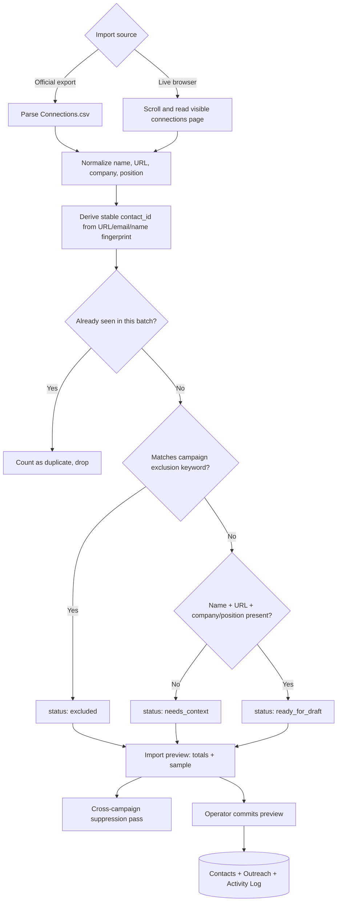

[Back to README](../README.md)

# 06 Import & Capture

## Summary

Contacts enter the system through one of two paths that converge on the same preview-and-suppression pipeline: parsing LinkedIn's official `Connections.csv` export (`src/services/connectionImporter.js`), or live-capturing the visible connections page through Playwright (`captureVisibleConnections` in [05 LinkedIn Automation & Safety](05-linkedin-automation-safety.md)). Both produce the same shape of preview, which the operator reviews before anything is written to Sheets.

## CSV Import

`parseConnectionsCsv` locates the real header row inside LinkedIn's export (which prepends a notes/legal preamble before the actual `First Name` header), maps LinkedIn's column names through an alias table (`First Name`/`FirstName`/`first_name`, etc.), and normalizes every LinkedIn profile URL to a canonical `https://www.linkedin.com/in/<slug>` form — stripping tracking parameters, locale subdomains, and trailing slashes.

## Identity and Deduplication

Every contact gets a **stable, content-derived ID**: `stableId('con', identity)`, where `identity` is the normalized profile URL, or the email, or a `firstName|lastName|company` composite if neither is available — hashed with SHA-256 and truncated. This means importing the same connection twice (from two different CSV exports, or a CSV followed by a live capture) always produces the same `contact_id`, so the batch-level dedup and the Sheets-level `createContactsBatch` idempotency check both catch it without needing a lookup table.

Rows that yield no usable identity at all are dropped with a warning instead of silently creating a broken record.

## Qualification Rules

Each row is classified while building the preview:

| Outcome | Condition |
| --- | --- |
| `excluded` | Company, position, or email matches a campaign exclusion keyword (semicolon/comma-separated list) |
| `needs_context` | Missing first name, missing LinkedIn URL, or missing both company and position |
| `ready_for_draft` | First name, LinkedIn URL, and at least one of company/position are present |

## Cross-Campaign Suppression

Before any preview can be committed, `applyCrossCampaignSuppression` (in `src/app.js`) re-checks it against the *entire* current state of Sheets — not just the current campaign — and removes anyone who is:

| Reason | Rule |
| --- | --- |
| `alreadyInCampaign` | An outreach row already exists for this contact in this exact campaign |
| `doNotContact` | The contact is flagged `do_not_contact`, or any prior outreach row has that status/outcome |
| `previouslyMessaged` | Any prior outreach row has `initial_sent_at`, `followup_sent_at`, or a post-send status |
| `uncertainSend` | Any prior outreach row is mid-send (`sending_initial`/`sending_followup`) — the outcome of that send is not yet known |
| `activeElsewhere` | The contact has an active, pre-send outreach row in another still-active campaign |

This check runs twice: once when the preview is first built, and again immediately before commit, because Sheets state can change in the window between generating a preview and clicking commit.

## Preview Lifetime

`ImportPreviewStore` holds previews in memory only, keyed by a random ID, for 30 minutes, and each preview is single-use (`take()` deletes it on read). This keeps large previews out of Sheets entirely until the operator explicitly commits, and naturally expires abandoned imports without any cleanup job.

## Screenshot

The CSV import path, captured against a fabricated `demo-connections.csv`. The live-capture alternative (`capture-visible.png`) is intentionally not shown — it only produces meaningful output against a real, logged-in LinkedIn session, which is out of scope for a sanitized portfolio asset. See the [screenshot plan](../screenshots/README.md) for the full reasoning.

See the [screenshot plan](../screenshots/README.md) for capture status.
