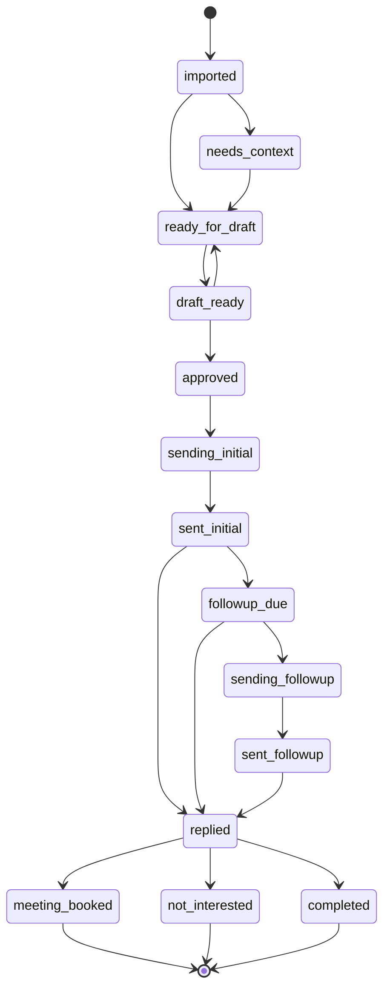

[Back to README](../README.md)

# 07 Outreach State Machine

## Summary

Every outreach record moves through an explicit, enumerated status graph defined once in `src/domain/model.js` and enforced centrally by `assertTransition()` inside `GoogleSheetsRepository.transitionOutreach()` — not scattered across route handlers. No code path, including a batch operation or a manual recovery action, can move a record to a status that isn't in the allow-list for its current status.



*(Simplified for readability — see [`diagrams/outreach-state-machine.mmd`](../diagrams/outreach-state-machine.mmd) for the full 18-status graph including `do_not_contact`, `excluded`, `no_response`, and `error`.)*

## The 18 Statuses

| Status | Meaning |
| --- | --- |
| `imported` | Just written from an import or capture commit |
| `needs_context` | Missing identity or professional context; cannot be drafted yet |
| `ready_for_draft` | Qualified; eligible for draft generation |
| `draft_ready` | An editable draft exists |
| `approved` | Reviewed and validated; eligible to send |
| `sending_initial` / `sending_followup` | Reserved mid-send; browser automation is in flight |
| `sent_initial` | Operator or Playwright confirmed the initial message was sent |
| `followup_due` | The one allowed follow-up has become due |
| `sent_followup` | The follow-up was sent |
| `replied`, `meeting_booked`, `not_interested`, `no_response`, `do_not_contact`, `completed` | Outcomes recorded by the operator |
| `excluded` | Removed from a campaign queue before any message was sent |
| `error` | A recoverable failure; requires manual review before recovery |

`TERMINAL_STATUSES` (`meeting_booked`, `not_interested`, `do_not_contact`, `completed`, `excluded`) are excluded from the active queue entirely — once a record reaches one of these, it stops appearing in any batch operation.

## Why Centralize This

Before this project, similar systems risk the classic bug: a UI button is disabled for a given status, but the API endpoint behind it doesn't independently check the current status, so a stale tab or a replayed request can still fire the transition. Here, `canTransition(from, to)` and `assertTransition(from, to)` are the single source of truth, called from inside `transitionOutreach()` itself — so *every* write path, including ones added later, inherits the same guarantee for free.

```js
const allowed = {
  approved: ['draft_ready', 'sending_initial', 'sent_initial', 'excluded', 'do_not_contact', 'error'],
  sending_initial: ['approved', 'sent_initial', 'error'],
  sent_initial: ['followup_due', 'replied', 'meeting_booked', 'not_interested', 'do_not_contact', 'completed', 'error'],
  // ...
};
```

## Optimistic Concurrency on Top

The state machine answers "is this transition legal in principle?" A second, independent check — `expectedVersion` against the record's stored `version` — answers "is the caller acting on the version of the record they actually saw?" Both checks run on every `transitionOutreach()` call; a stale read fails with a `VERSION_CONFLICT` (mapped to HTTP 409) even if the transition itself would otherwise be legal. This is what makes it safe for two browser tabs, or a manual action racing a batch operation, to operate on the same queue concurrently.

## Screenshot


One outreach record's history, newest first: `draft_approved`, then `draft_edited` ("Operator tightened the opening line."), then `draft_generated`. Every transition in this system leaves exactly this kind of trail.

See the [screenshot plan](../screenshots/README.md) for capture status.
