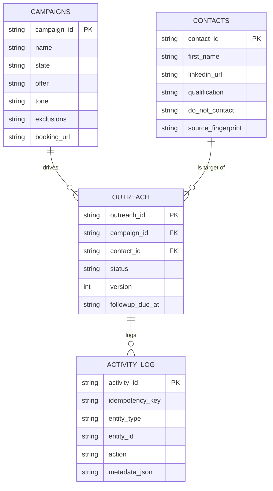

[Back to README](../README.md)

# 08 Data Model

## Summary

Google Sheets is the entire persistence layer: four tabs, each with a fixed header row defined once in `SHEETS` (`src/domain/model.js`) and validated on every health check. There is no ORM — `rowToObject`/`objectToRow` map between a header array and a plain object, and every write is a batched `spreadsheets.values.batchUpdate` call so an entity write and its Activity Log entry land atomically from the caller's perspective.

## Campaigns

`campaign_id, name, state, audience_criteria, offer, tone, proof_points, exclusions, booking_url, initial_template, followup_template, created_at, updated_at`

`state` is one of `draft`, `active`, `paused`, `completed`. Pausing a campaign (`POST /api/campaigns/:id/state`) also walks every `sent_initial`/`followup_due` outreach row in that campaign and force-transitions it to `completed`, cancelling any pending follow-up — a campaign-level safety valve independent of individual contact review.

## Contacts

`contact_id, first_name, last_name, linkedin_url, email, company, position, connected_on, relationship_context, qualification, exclusion_reason, do_not_contact, source_fingerprint, created_at, updated_at`

`contact_id` is a stable SHA-256-derived ID (see [06 Import & Capture](06-import-and-capture.md)), so the same person imported twice — via CSV, via live capture, in different campaigns — always resolves to one Contacts row. `do_not_contact` is a global flag: setting it on one outreach record propagates to the Contacts row itself, so it suppresses that person everywhere, forever, not just in the campaign where they opted out.

## Outreach

`outreach_id, campaign_id, contact_id, status, initial_draft, followup_draft, approved_at, initial_sent_at, followup_due_at, followup_sent_at, outcome, outcome_at, last_error, version, created_at, updated_at`

This is the row that actually moves through the [state machine](07-outreach-state-machine.md). One `(campaign_id, contact_id)` pair maps to exactly one Outreach row — `outreach_id` is itself derived (`stableId('out', campaign_id|contact_id)`), which is what lets the suppression logic in [06 Import & Capture](06-import-and-capture.md) detect "already in this campaign" without a secondary index.

## Activity Log

`activity_id, idempotency_key, occurred_at, actor, entity_type, entity_id, action, prior_status, new_status, note, metadata_json`

Append-only. Every campaign creation, contact update, and outreach transition writes one row here in the same batched call as the entity write itself. `idempotency_key` is what `hasIdempotencyKey()` checks before honoring a write — if the key has already been logged, the write is treated as a no-op duplicate and the existing record is returned instead. This single mechanism backs idempotent imports, idempotent sends, and safe client retries throughout the API.

## Sheet Setup

`src/services/sheetSetup.js` (run via `npm run setup:sheets`) is idempotent: it creates any missing tabs, refuses to overwrite a tab whose header row already exists but doesn't match the expected schema (forcing manual repair instead of silent data loss), freezes the header row, applies a basic filter, auto-resizes columns, and adds dropdown data validation for `state`, `qualification`, `status`, and `outcome` columns so manual edits in the sheet stay within the allowed enum values.

## Screenshot

The Campaigns tab's fields — name, offer, tone, exclusions, booking URL — mapped directly onto the campaign creation form. See [07 Outreach State Machine](07-outreach-state-machine.md) for the related activity-log capture.
