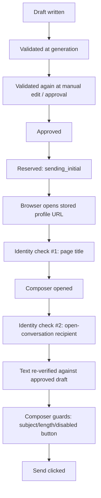

[Back to README](../README.md)

# 10 Engineering Decisions

## Decision Summary

The architecture consistently trades raw throughput for verifiability. Nearly every major decision below chooses the option that makes a wrong send *structurally harder*, even when a faster or simpler alternative existed.

## Key Trade-offs

| Decision | Trade-off | Outcome |
| --- | --- | --- |
| Google Sheets as the database | No transactions, real per-minute quotas, less robust than SQL | Operator-inspectable, editable system of record with zero hosting overhead |
| Attended Playwright, not headless | Slower, requires a visible window and manual login handling | Login/checkpoint/2FA stays human-owned; account risk stays low |
| One persistent browser context | No concurrent sends; a `busy` flag serializes all automation | Avoids two automated sessions racing the same LinkedIn account |
| Same validator for AI and template drafts | More code paths run through validation, not fewer | "AI-generated" never means "less scrutinized" |
| Double identity verification before send | Two extra checks, more places a send can legitimately abort | A message can only reach the profile it was written for |
| Optimistic concurrency (`version`) everywhere | Every write handler must thread `expectedVersion` through | Two tabs or a batch job racing a manual action fail safely, not silently |
| Idempotency keys on every mutation | Callers must track and resend keys correctly | Retries after a crash or double click never duplicate a send or an import |
| State machine centralized in the repository layer | Every transition, including future ones, must pass through `assertTransition` | Impossible states are rejected at the data layer, not just hidden in the UI |
| Cross-campaign suppression, not per-campaign | An extra full-table scan on every import/send | A person can never be double-messaged just because two campaigns overlap |

## Send Safety, Layer by Layer

Each layer is independently sufficient to abort the send. None of them trusts the layer before it — the composer is re-checked even though the draft was already validated twice, because the thing being verified (what LinkedIn's DOM currently shows) can only be observed at that moment.

## Why Not a Real Database

A Postgres- or SQLite-backed version of this system would remove the Sheets quota constraint and add real transactions. It was deliberately not chosen here because the target operator is not necessarily technical: being able to open the spreadsheet, see every campaign and contact, and understand the audit trail without a separate admin UI is a real product requirement for a small-scale, human-reviewed outreach tool. [13 Future Improvements](13-future-improvements.md) revisits this once volume grows past what Sheets can comfortably serve.

## Screenshot

**Planned:** No dedicated screenshot; this document is conceptual.
